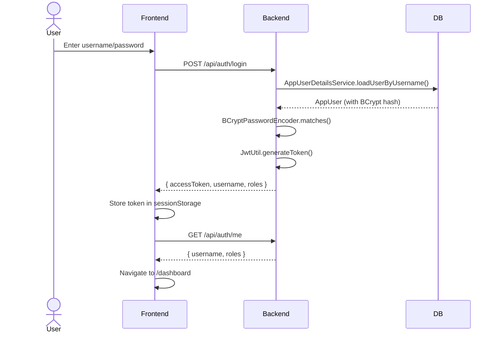
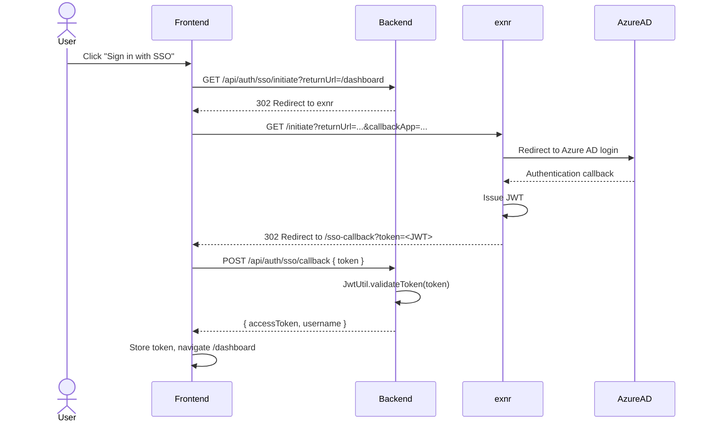
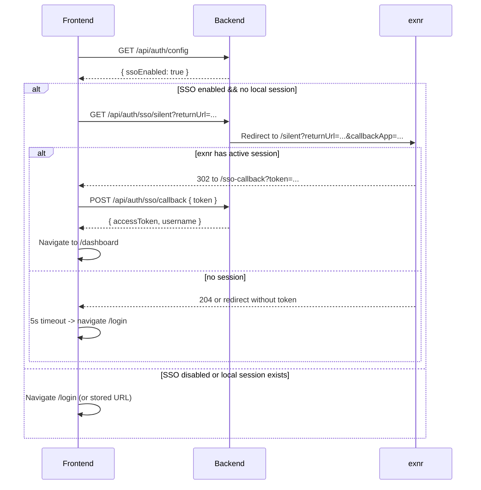

# xfcs-reloader Authentication Architecture

## 1. Overview

xfcs-reloader supports **two independent authentication paths**:

| Path | Protocol | Dependency | User Experience |
|------|----------|------------|-----------------|
| **Local** | BCrypt + JWT | None (self-contained) | Username/password form |
| **SSO** | OAuth2 via exnr | exnr backend must be reachable | Redirect to Azure AD via exnr |

Both paths issue the **same JWT format**, so the rest of the app does not need to know which path the user chose.

---

## 2. Local Authentication (Independent)

### 2.1 Data Model

Managed by Liquibase changelog: `db.changelog-7.3-local-auth.xml`

- `app_user` — stores `username`, `password_hash` (BCrypt), `enabled`, timestamps
- `app_user_role` — stores `username`, `role` (composite key `AppUserRoleId`)

Default role: `USER` (configurable via `xfcsreloader.auth.default-role`)

### 2.2 Backend Endpoints

All under `/api/auth`:

| Method | Path | Auth | Description |
|--------|------|------|-------------|
| POST | `/api/auth/register` | Public | Creates new user (when `register-enabled=true`) |
| POST | `/api/auth/login` | Public | Validates credentials, returns JWT |
| POST | `/api/auth/refresh` | Bearer JWT | Issues new JWT before expiry |
| GET | `/api/auth/me` | Bearer JWT | Returns current username + roles |
| POST | `/api/auth/logout` | Bearer JWT | Clears session (no-op for stateless JWT) |
| GET | `/api/auth/config` | Public | Returns `{ ssoEnabled, registerEnabled }` |

#### Login Flow (Local)

```
Frontend                      Backend
  |                              |
  | POST /api/auth/login         |
  | { username, password }       |
  |----------------------------->|
  |                              | AuthenticationManager.authenticate()
  |                              | -> AppUserDetailsService.loadUserByUsername()
  |                              | -> BCryptPasswordEncoder.matches()
  |                              |
  |                              | JwtUtil.generateToken(username, roles)
  |                              |
  | <-----------------------------|
  | { accessToken, username, roles } |
  |                              |
  | store token in sessionStorage |
  | loadMe() -> /api/auth/me     |
  |----------------------------->|
  | <-----------------------------|
  | { username, roles }          |
```

### 2.3 Password Encoding

- Algorithm: BCrypt
- Encoder bean: `SecurityConfig.passwordEncoder()`
- Passwords stored in `app_user.password_hash`
- Registration encodes before persisting: `passwordEncoder.encode(request.password())`

### 2.4 JWT Handling

- Utility: `JwtUtil.java`
- Signed with `reloader.jwt.secret` from `application.yml`
- Default dev secret: `dev-secret-change-me-please-32-bytes`
- Contains claims: `sub` (username), `roles`, `exp`
- Frontend auto-refreshes before expiry using `setTimeout` based on JWT `exp` claim

### 2.5 Frontend Components

| File | Responsibility |
|------|----------------|
| `auth.service.ts` | Login, logout, refresh, `loadMe()`, token storage |
| `login.component.ts` | Local login form + SSO button |
| `register.component.ts` | Local registration form |
| `auth.guard.ts` | Protects routes requiring authentication |
| `auth.interceptor.ts` | Attaches `Authorization: Bearer <token>` to API calls |

---

## 3. SSO Authentication (Dependent on exnr)

### 3.1 Architecture

xfcs-reloader is **not** an OAuth2 client itself. Instead, it delegates SSO to exnr:

```
User Browser
    |
    | 1. Click "Sign in with onsemi SSO"
    |
    +---> xfcs-reloader /api/auth/sso/initiate
              |
              | 2. Redirect to exnr /initiate?returnUrl=...&callbackApp=...
              |
    <--------- exnr (Azure AD login page)
              |
    | 3. User authenticates with Azure AD
              |
              | 4. exnr issues JWT, redirects to callback URL
              |
    <--------- xfcs-reloader /sso-callback?token=<JWT>
              |
    | 5. Frontend extracts token, calls /api/auth/sso/callback
              |
    | 6. Backend validates JWT signature (shared secret)
    |    OR (current implementation) accepts DTP-issued token
              |
    | 7. Frontend stores token, redirects to /dashboard
```

### 3.2 Backend SSO Endpoints

| Method | Path | Auth | Description |
|--------|------|------|-------------|
| GET | `/api/auth/sso/initiate` | Public | Redirects to exnr's SSO entry point |
| GET | `/api/auth/sso/silent` | Public | Silent SSO check (used on app startup) |
| POST | `/api/auth/sso/callback` | Public | Accepts DTP-issued JWT, validates, returns access token |

#### SSO Initiate Flow

```
Frontend                      Backend (xfcs-reloader)          exnr
  |                              |                              |
  | GET /api/auth/sso/initiate   |                              |
  | ?returnUrl=/dashboard        |                              |
  |----------------------------->|                              |
  |                              | if (!ssoEnabled) 400         |
  |                              |                              |
  |                              | Build redirect URL:          |
  |                              | exensioAuthUrl +             |
  |                              |   "/initiate?returnUrl=..."  |
  |                              |   + "&callbackApp=" +       |
  |                              |   callbackUrl                |
  |                              |                              |
  | <-- 302 Redirect -------------|----------------------------->|
  |                              |                              | Azure AD login
  |                              |                              |
  | <-- 302 Redirect (with JWT) --|-----------------------------|
  | /sso-callback?token=...       |                              |
  |                              |                              |
  | POST /api/auth/sso/callback  |                              |
  | { token }                    |                              |
  |----------------------------->|                              |
  |                              | jwtUtil.validateToken(token) |
  |                              | extract username from claims |
  |                              |                              |
  | <-----------------------------|                              |
  | { accessToken, username }     |                              |
  |                              |                              |
  | store token, navigate /dashboard                            |
```

#### Silent SSO (App Startup)

On app init, if SSO is enabled and no local session exists:

1. Frontend calls `GET /api/auth/sso/silent?returnUrl=<currentUrl>`
2. Backend redirects to exnr's silent endpoint
3. If exnr has an active session, redirects back with JWT
4. If no session, exnr returns 204 or redirects with no token
5. Frontend timeout (5s) → navigates to `/login`

### 3.3 Configuration

Properties in `application.yml`:

```yaml
sso:
  enabled: ${SSO_ENABLED:true}
  exensio-auth-url: ${SSO_EXENSIO_AUTH_URL:https://usaz15ls088:8080/exensio-reload/api/auth/sso}
  callback-url: ${SSO_CALLBACK_URL:https://usaz15ls088:8080/xfcs-reloader/sso-callback}
```

| Property | Required | Default | Description |
|----------|----------|---------|-------------|
| `sso.enabled` | No | `true` | Master switch for SSO endpoints |
| `sso.exensio-auth-url` | Yes (if SSO enabled) | exnr dev URL | Base URL of exnr's auth API |
| `sso.callback-url` | Yes (if SSO enabled) | xfcs-reloader dev URL | Where exnr redirects after auth |

### 3.4 SSO Dependencies

**xfcs-reloader depends on exnr for SSO because:**

1. **Azure AD registration is in exnr** — xfcs-reloader does not have its own OAuth2 client ID/secret
2. **Token validation** — xfcs-reloader validates the JWT issued by exnr using `JwtUtil`
3. **Callback orchestration** — exnr handles the OAuth2 flow and redirects back to xfcs-reloader

**If exnr is down:**
- Local authentication continues to work
- SSO button shows error or hangs (5s timeout to login page)
- No impact on core reload functionality

---

## 4. Security Considerations

### 4.1 JWT Secret

- Local JWTs are signed with `reloader.jwt.secret`
- SSO JWTs are issued by exnr (different secret potentially)
- **Risk**: If exnr and xfcs-reloader use different secrets, SSO validation fails
- **Mitigation**: Current implementation accepts DTP-issued tokens; for production, align secrets or use asymmetric keys

### 4.2 Token Storage

- Frontend stores tokens in `sessionStorage` (primary) and `localStorage` (fallback)
- `sessionStorage` cleared on tab close
- `localStorage` persists across sessions
- Tokens auto-refresh 30 seconds before expiry

### 4.3 CORS

Allowed origins (configurable in `application.yml`):

```yaml
security:
  allowed-origins: >
    http://localhost:4200,
    http://localhost:5173,
    http://localhost:8080,
    http://usaz15ls088:8080,
    http://usaz15ls088:8005,
    http://usaz15ls088,
    https://usaz15ls088:8080,
    https://usaz15ls088:8005,
    https://usaz15ls088
```

### 4.4 CSRF

Disabled for API endpoints (`csrf.disable()`) because JWT is used in Authorization header, not cookies.

### 4.5 Session Management

- Stateless JWT (no server-side session)
- Refresh mechanism via `/api/auth/refresh`
- No concurrent session tracking

---

## 5. Frontend Authentication Flow

### 5.1 App Initialization

```
app.config.ts
  |
  | APP_INITIALIZER: authInitializerFactory()
  |
  +-> AuthService.loadAuthConfig()
  |     GET /api/auth/config
  |     -> ssoEnabled signal updated
  |
  +-> if (ssoEnabled && !isAuthenticated())
  |     AuthService.trySilentSso(returnUrl)
  |       |
  |       | setTimeout(5000ms) -> navigate /login
  |       |
  |       | window.location.href = /api/auth/sso/silent?returnUrl=...
  |       |   |
  |       |   | (if exnr has session -> redirect to /sso-callback?token=...)
  |       |   | (if no session -> 204 or redirect without token)
  |       |   |
  |       |   SsoCallbackComponent extracts token
  |       |   -> AuthService.handleSsoCallback(token)
  |       |   -> navigate /dashboard
  |
  +-> else
        navigate /login (or stored returnUrl)
```

### 5.2 Login Page States

| Condition | What User Sees |
|-----------|----------------|
| SSO enabled, no session | Local form + "Sign in with onsemi SSO" button |
| SSO disabled, no session | Local form only |
| Already authenticated | Redirected to `/dashboard` |
| SSO error (`?reason=sso-error`) | Red error banner + local form |

### 5.3 Route Protection

```typescript
// auth.guard.ts
canActivate(): boolean {
  if (authService.isAuthenticated()) return true;
  return this.router.navigate(['/login']);
}
```

Protected routes: `/dashboard`, `/history`, `/monitor`, `/analytics`, `/coverage`, `/reload/new`

Public routes: `/login`, `/register`, `/verify`, `/request-reset`, `/reset-password`, `/sso-callback`

---

## 6. Backend Security Configuration

### 6.1 Filter Chain

```
HttpSecurity
  |
  +-> CSRF disabled
  +-> CORS enabled
  +-> Session: STATELESS
  +-> Exception handling: RestAuthenticationEntryPoint (401 on missing/invalid JWT)
  |
  +-> Permit all:
  |     /api/auth/**
  |     /api/public/**
  |     /actuator/**
  |     /error
  |
  +-> Authenticate:
  |     /api/**
  |
  +-> Filters:
        JwtAuthenticationFilter (after SecurityContextHolderFilter)
```

### 6.2 JwtAuthenticationFilter

1. Extract `Authorization: Bearer <token>` header
2. Call `JwtUtil.validateToken(token)`
3. If valid, load user details from `AppUserDetailsService`
4. Set `SecurityContextHolder` authentication
5. If invalid/missing, continue as anonymous → 401 at endpoint level

---

## 7. Configuration Reference

### 7.1 application.yml (xfcs-reloader)

```yaml
# JWT signing secret for locally-issued tokens
reloader:
  jwt:
    secret: ${RELOADER_JWT_SECRET:dev-secret-change-me-please-32-bytes}

# Local auth settings
xfcsreloader:
  auth:
    default-role: USER                    # Default role for new registrations
    register-enabled: ${XFCS_AUTH_REGISTER_ENABLED:true}  # Allow public registration

# SSO settings (delegates to exnr)
sso:
  enabled: ${SSO_ENABLED:true}            # Master SSO switch
  exensio-auth-url: ${SSO_EXENSIO_AUTH_URL:https://usaz15ls088:8080/exensio-reload/api/auth/sso}
  callback-url: ${SSO_CALLBACK_URL:https://usaz15ls088:8080/xfcs-reloader/sso-callback}

# CORS allowed origins
security:
  allowed-origins: >-
    http://localhost:4200,
    ...
```

### 7.2 Environment Variables

| Variable | Purpose |
|----------|---------|
| `RELOADER_JWT_SECRET` | Secret for signing local JWTs |
| `XFCS_AUTH_REGISTER_ENABLED` | Enable/disable public registration |
| `SSO_ENABLED` | Enable/disable SSO endpoints |
| `SSO_EXENSIO_AUTH_URL` | exnr base URL for SSO |
| `SSO_CALLBACK_URL` | xfcs-reloader callback URL for SSO |

---

## 8. Entity Reference

### 8.1 AppUser

```java
@Entity
@Table(name = "app_user")
public class AppUser {
    @Id
    @Column(name = "username")
    private String username;          // Primary key
    
    @Column(name = "password_hash")
    private String passwordHash;      // BCrypt hash
    
    @Column(name = "enabled")
    private Boolean enabled = true;
    
    @Column(name = "created_at")
    private LocalDateTime createdAt;
    
    @Column(name = "updated_at")
    private LocalDateTime updatedAt;
    
    @OneToMany(mappedBy = "appUser", cascade = CascadeType.ALL, orphanRemoval = true)
    private Set<AppUserRole> authorities = new HashSet<>();
}
```

### 8.2 AppUserRole

```java
@Entity
@Table(name = "app_user_role")
public class AppUserRole {
    @EmbeddedId
    private AppUserRoleId id;         // Composite key (username + role)
    
    @MapsId
    @ManyToOne
    @JoinColumn(name = "username")
    private AppUser appUser;
}
```

### 8.3 AppUserRoleId

```java
@Embeddable
public class AppUserRoleId implements Serializable {
    @Column(name = "username")
    private String username;
    
    @Column(name = "role")
    private String role;
}
```

---

## 9. Sequence Diagrams

### 9.1 Local Login



### 9.2 SSO Login (via exnr)



### 9.3 Silent SSO (App Startup)



---

## 10. Troubleshooting

### 10.1 SSO Redirects to Login

**Symptoms**: User clicks SSO, gets redirected back to `/login` with no token.

**Possible causes**:
1. `sso.enabled=false` in `application.yml`
2. exnr unreachable (network issue, service down)
3. `sso.exensio-auth-url` misconfigured
4. exnr returns error (invalid `callbackApp`, misconfigured Azure AD)
5. 5-second timeout expired

**Debug steps**:
```bash
# Check backend logs for SSO initiation
grep -i "sso" backend.log

# Verify exnr is reachable
curl -I https://usaz15ls088:8080/exensio-reload/api/auth/sso

# Check config endpoint
curl https://usaz15ls088:8005/xfcs-reloader/api/auth/config
```

### 10.2 Local Login Fails

**Symptoms**: Invalid credentials error even with correct username/password.

**Possible causes**:
1. User not registered (check `app_user` table)
2. Password hash corrupted (BCrypt mismatch)
3. `AppUserDetailsService` not loading user correctly
4. Database not migrated (Liquibase not run)

**Debug steps**:
```sql
-- Check if user exists
SELECT username, enabled FROM app_user WHERE username = 'test';

-- Check roles
SELECT * FROM app_user_role WHERE username = 'test';
```

### 10.3 JWT Validation Fails

**Symptoms**: 401 on authenticated endpoints, tokens rejected.

**Possible causes**:
1. `reloader.jwt.secret` changed after tokens were issued
2. Token expired (default JWT expiry not configured in `JwtUtil`)
3. Clock skew between servers

**Debug steps**:
```bash
# Decode JWT payload (no verification)
echo "<token>" | cut -d. -f2 | base64 -d | jq .

# Check expiry
jq '.exp' <<< "$(echo "<token>" | cut -d. -f2 | base64 -d)"
```

---

## 11. Comparison with exnr

| Feature | xfcs-reloader | exnr |
|---------|---------------|------|
| Local auth | BCrypt + JWT | BCrypt + JWT + RefreshToken |
| SSO | Delegates to exnr | Own OAuth2 client (Azure AD) |
| User management | `app_user`, `app_user_role` | `app_user`, `app_user_role`, `refresh_token` |
| Token refresh | `POST /api/auth/refresh` (JWT rotation) | `POST /api/auth/refresh` (cookie-based) |
| Password reset | Not implemented | Full email flow with token |
| Session tracking | None (stateless JWT) | Refresh token rotation |
| Registration | `POST /api/auth/register` | `POST /api/auth/register` + email verification |

---

## 12. Future Improvements

1. **Independent SSO**: Register xfcs-reloader as its own OAuth2 client in Azure AD, eliminating exnr dependency
2. **Refresh tokens**: Add server-side refresh token rotation for better security
3. **Password reset**: Implement email-based reset flow
4. **Session management**: Track active sessions, allow revocation
5. **Role-based access control**: Map roles to specific reload permissions
6. **Audit logging**: Log login/logout events with IP and user agent
