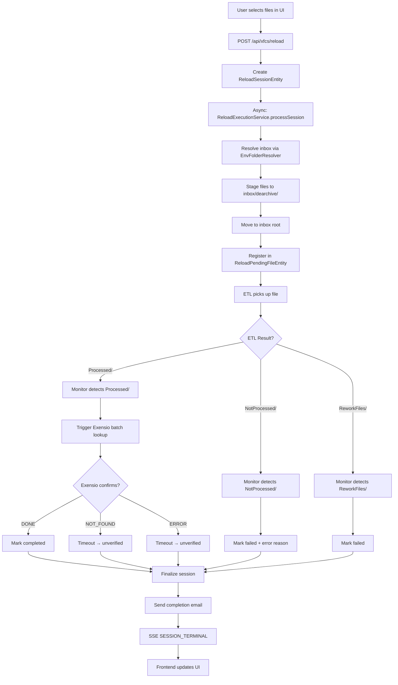
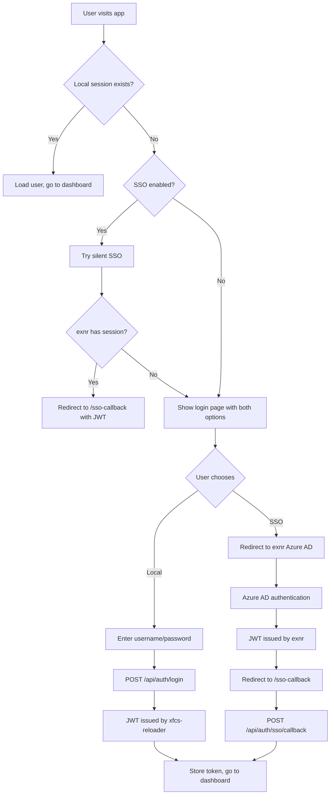
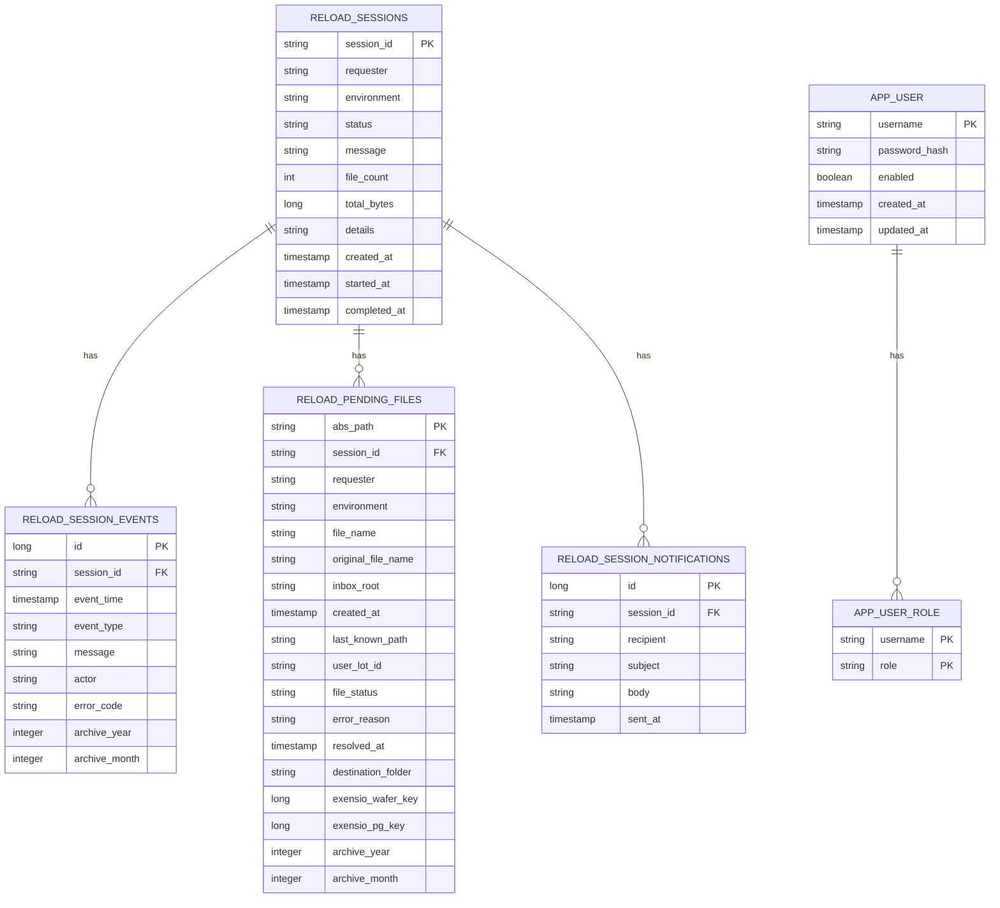

# xfcs-reloader System Architecture

## 1. System Overview

xfcs-reloader is a Spring Boot + Angular application for orchestrating archived file reloads into Exensio. It provides:

- **Archive search** — browse and download archived files by lot ID, year, month
- **Reload orchestration** — stage files to ETL inbox, monitor ETL processing, verify Exensio loading
- **Pre-check** — validate lots against Exensio before reload
- **Session tracking** — real-time status via SSE, event history, coverage analytics
- **Dual auth** — local BCrypt credentials or SSO via exnr

### 1.1 Technology Stack

| Layer | Technology |
|-------|-----------|
| Backend framework | Spring Boot 3.x (Java) |
| Frontend framework | Angular 17+ (standalone, signals, OnPush) |
| Database | H2 (dev), Oracle/PostgreSQL (prod) via Liquibase |
| Authentication | JWT (local BCrypt) + SSO (delegated to exnr) |
| Real-time events | Server-Sent Events (SSE) |
| Remote access | SSH (JSch) for remote .mgr/.cfg/log reads |
| Analytics | Snowflake JDBC (pre-check), Exensio raw-SQL (fallback) |

### 1.2 Deployment Topology

```
┌─────────────────────────────────────────────────────────────┐
│                        User Browser                          │
│                  (Angular SPA, port 4200)                    │
└──────────────────────┬──────────────────────────────────────┘
                       │ HTTPS
                       ▼
┌─────────────────────────────────────────────────────────────┐
│                   xfcs-reloader Backend                      │
│                   (Spring Boot, port 8005)                   │
│                   context-path: /xfcs-reloader               │
│                                                              │
│  ┌──────────────┐  ┌──────────────┐  ┌──────────────────┐  │
│  │ Auth         │  │ Xfcs         │  │ Scheduled Tasks  │  │
│  │ Controller   │  │ Controller   │  │ (PendingMonitor) │  │
│  └──────────────┘  └──────────────┘  └──────────────────┘  │
│                                                              │
│  ┌──────────────────────────────────────────────────────┐   │
│  │                  Service Layer                         │   │
│  │  ReloadSession | ReloadExecution | ReloadPendingMonitor│  │
│  │  ExensioClient | ExensioPreCheck | ArchiveSearch       │  │
│  │  EnvConfig     | EnvFolderResolver | PpLogQuery        │  │
│  └──────────────────────────────────────────────────────┘   │
└───────┬──────────────┬──────────────┬──────────────┬────────┘
        │              │              │              │
        ▼              ▼              ▼              ▼
┌──────────────┐ ┌──────────────┐ ┌──────────────┐ ┌──────────────┐
│   Database   │ │   Exensio    │ │   Snowflake  │ │   Remote     │
│   (H2/Oracle)│ │   API        │ │   (precheck) │ │   SSH Host   │
│   Liquibase  │ │   HTTP       │ │   JDBC       │ │   .mgr/.cfg  │
└──────────────┘ └──────────────┘ └──────────────┘ └──────────────┘
                       ▲
                       │
                       │ (SSO only)
                       ▼
                ┌──────────────┐
                │    exnr      │
                │  (Azure AD)  │
                └──────────────┘
```

---

## 2. Backend Architecture

### 2.1 Application Entry Point

```
XfcsReloaderApplication
├── @SpringBootApplication
├── @EnableConfigurationProperties(XfcsProperties.class)
└── @EnableScheduling
```

- Main class: `XfcsReloaderApplication.java`
- Port: `8005` (configurable via `server.port`)
- Context path: `/xfcs-reloader`
- Enables scheduling for `ReloadPendingMonitor`

### 2.2 Layered Architecture

```
┌─────────────────────────────────────────────────────────────┐
│  Web Layer                                                   │
│  ┌────────────────────┐  ┌──────────────────────────────┐  │
│  │ AuthController     │  │ XfcsController              │  │
│  │ @RequestMapping    │  │ @RequestMapping("/api/xfcs")│  │
│  │ ("/api/auth")      │  │                              │  │
│  └────────────────────┘  └──────────────────────────────┘  │
│                                                              │
│  ┌──────────────────────────────────────────────────────┐   │
│  │ Filters                                               │   │
│  │  - JwtAuthenticationFilter                            │   │
│  │  - AuthDebugFilter                                    │   │
│  └──────────────────────────────────────────────────────┘   │
├─────────────────────────────────────────────────────────────┤
│  Service Layer                                               │
│  ┌──────────────────────────────────────────────────────┐   │
│  │ Core orchestration                                    │   │
│  │  - ReloadSessionService (CRUD, status, events)        │   │
│  │  - ReloadExecutionService (async staging)             │   │
│  │  - ReloadPendingMonitor (ETL + Exensio monitoring)    │   │
│  ├──────────────────────────────────────────────────────┤   │
│  │ External integrations                                 │   │
│  │  - ExensioClient (HTTP API client)                    │   │
│  │  - ExensioAuthService (per-schema tokens)             │   │
│  │  - ExensioPreCheckService (Snowflake + raw-SQL)       │   │
│  │  - ArchiveSearchService (filesystem search)           │   │
│  │  - EnvConfigService (env.conf parsing)                │   │
│  │  - EnvFolderResolver (.mgr → .cfg → inbox)           │   │
│  │  - PpLogQueryService (refdb.pp_log queries)           │   │
│  │  - SseEventBroker (SSE pub/sub)                       │   │
│  │  - AppUserDetailsService (local auth)                 │   │
│  └──────────────────────────────────────────────────────┘   │
├─────────────────────────────────────────────────────────────┤
│  Repository Layer                                             │
│  ┌────────────────────┐  ┌──────────────────────────────┐   │
│  │ ReloadSessionRepo   │  │ ReloadPendingFileRepo        │   │
│  │ (JpaRepository)     │  │ (custom queries)             │   │
│  ├────────────────────┤  ├──────────────────────────────┤   │
│  │ ReloadSessionEvent  │  │ ReloadSessionNotification    │   │
│  │ Repository          │  │ Repository                   │   │
│  ├────────────────────┤  ├──────────────────────────────┤   │
│  │ AppUserRepository   │  │                              │   │
│  └────────────────────┘  └──────────────────────────────┘   │
├─────────────────────────────────────────────────────────────┤
│  Entity Layer                                                 │
│  ┌────────────────────┐  ┌──────────────────────────────┐   │
│  │ ReloadSessionEntity│  │ ReloadPendingFileEntity      │   │
│  │ (session master)   │  │ (per-file tracking)          │   │
│  ├────────────────────┤  ├──────────────────────────────┤   │
│  │ ReloadSessionEvent │  │ ReloadSessionNotification    │   │
│  │ Entity             │  │ Entity                       │   │
│  ├────────────────────┤  ├──────────────────────────────┤   │
│  │ AppUser            │  │ AppUserRole                  │   │
│  │ (local auth)       │  │ (local auth roles)           │   │
│  └────────────────────┘  └──────────────────────────────┘   │
├─────────────────────────────────────────────────────────────┤
│  Configuration Layer                                          │
│  SecurityConfig, JwtUtil, ExensioProperties, XfcsProperties  │
│  PpLogDbProperties, RefDbProperties, DataSourceConfig, etc.  │
└─────────────────────────────────────────────────────────────┘
```

### 2.3 Core Data Model

#### ReloadSessionEntity
Primary entity for reload sessions. Table: `xfcs_dearchiver_reload_sessions`

| Field | Type | Description |
|-------|------|-------------|
| `sessionId` | String (PK) | UUID |
| `requester` | String | Username |
| `environment` | String | Target environment |
| `site`, `area`, `testerType` | String | Site/area/tester metadata |
| `status` | String | created → processing → completed/failed/partially_failed/cancelled |
| `message` | String | Human-readable status |
| `fileCount` | Integer | Total files requested |
| `totalBytes` | Long | Total size |
| `details` | String (LOB) | JSON of original `ReloadRequest` |
| `createdAt`, `startedAt`, `completedAt` | Instant | Timestamps |

#### ReloadPendingFileEntity
Tracks each file through ETL processing. Table: `xfcs_dearchiver_reload_pending_files`

| Field | Type | Description |
|-------|------|-------------|
| `absPath` | String (PK) | Absolute path to staged file |
| `sessionId` | String | FK to session |
| `fileName` | String | Transformed filename (with `_reloaded_<ts>`) |
| `originalFileName` | String | Original archive filename |
| `inboxRoot` | String | Base inbox path |
| `fileStatus` | String | pending → staging → etl_complete → completed/failed |
| `errorReason` | String | ETL rejection reason |
| `destinationFolder` | String | PRODUCTION or SANDBOX |
| `exensioWaferKey`, `exensioPgKey` | Long | Exensio keys after confirmation |
| `archiveYear`, `archiveMonth` | Integer | For coverage analytics |
| `createdAt`, `resolvedAt` | Instant | Lifecycle timestamps |

#### ReloadSessionEventEntity
Append-only event log. Table: `xfcs_dearchiver_reload_session_events`

| Field | Type | Description |
|-------|------|-------------|
| `id` | Long (PK) | Auto-increment |
| `sessionId` | String | FK to session |
| `eventTime` | Instant | When the event occurred |
| `eventType` | String | e.g. SESSION_CREATED, FILE_STARTED, file_completed |
| `message` | String | Human-readable description |
| `actor` | String | Who/what triggered the event |
| `errorCode` | String | Error code if applicable |
| `archiveYear`, `archiveMonth` | Integer | For coverage grouping |

### 2.4 Key Service Flows

#### 2.4.1 Reload Execution Flow

```
User (Frontend)
    │
    │ POST /api/xfcs/reload { environment, files[] }
    ▼
XfcsController.createReload()
    │
    │ 1. Create ReloadSessionEntity (status=created)
    │ 2. Dispatch async processing AFTER transaction commits
    ▼
ReloadExecutionService.processSession() [@Async]
    │
    │ 1. Resolve inbox/staging via EnvFolderResolver
    │    (.mgr → .cfg → env vars → inbox path)
    │ 2. Create staging directory
    │ 3. For each file:
    │    a. Copy source → staging
    │    b. Decompress .gz if needed
    │    c. Transform filename (strip MD5, add _reloaded_<ts>)
    │    d. Move staging → inbox root
    │    e. Register in ReloadPendingFileEntity (status=pending)
    │ 4. Session status → processing
    ▼
ETL picks up file from inbox
    │
    │ (file moves to Processed/ or NotProcessed/)
    ▼
ReloadPendingMonitor.scanPendingFiles() [@Scheduled, every 5s]
    │
    │ 1. Find all pending files
    │ 2. Recursively search env tree for each file
    │ 3. Detect state transitions:
    │    - inbox root      → staging
    │    - Processed/      → etl_complete (or completed if Exensio disabled)
    │    - NotProcessed/   → failed (read .err reason)
    │    - ReworkFiles/    → failed
    │ 4. If all files crossed ETL fence:
    │    a. Resolve pgc_key from area/testerType
    │    b. Call ExensioClient.lotWaferLookupBatch()
    │    c. Process DONE/NOT_FOUND/ERROR updates
    │ 5. If all files terminal:
    │    a. Finalize session (completed/partially_failed/failed)
    │    b. Send completion email if configured
    ▼
Session terminal → SSE SESSION_TERMINAL event
    │
    ▼
Frontend updates UI
```

#### 2.4.2 Exensio Confirmation Flow

```
ReloadPendingMonitor
    │
    │ Files reached etl_complete status
    ▼
ExensioClient.lotWaferLookupBatch(records, pgcKey)
    │
    │ 1. Partition records by destinationFolder → schema
    │    (PRODUCTION → central_prod, SANDBOX → central_sand)
    │ 2. For each schema:
    │    a. Get token from ExensioAuthService (per-schema cache)
    │    b. Try filename-based discovery (primary)
    │       - raw_file JOIN op_log ON rawfile_key
    │       - Match filename prefix LIKE pattern
    │       - Filter by insert_time window
    │    c. If no matches, try raw-SQL fallback
    │       - POST /v1/key/raw-sql
    │       - Oracle SQL: op_log JOIN lot JOIN program
    │         LEFT JOIN wf_log LEFT JOIN wafer LEFT JOIN df_export
    │    d. If raw-SQL empty/error, try lot-wafer-lookup fallback
    │       - POST /v1/key/lot-wafer-lookup
    │    e. Retry up to 3x with exponential backoff
    │    f. Invalidate token on 401, re-login
    ▼
BatchLookupResult (per-file DONE/NOT_FOUND/ERROR)
    │
    ▼
ReloadPendingMonitor updates each file:
    - DONE      → completed (with Exensio keys, schema, insertTime)
    - NOT_FOUND → unverified-exensio (after timeout)
    - ERROR     → unverified-exensio (after timeout)
```

#### 2.4.3 Exensio Pre-Check Flow

```
Frontend
    │ POST /api/xfcs/lots/exensio-precheck { lotIds, blocks }
    ▼
ExensioPreCheckService.check()
    │
    │ Primary: Snowflake JDBC
    │ - Query ANALYTICSPRD.MFG.EXENSIO_PROD_OPLOG_METADATA
    │ - JSON array bind for lot IDs
    │ - Optional INSERT_TIME lower bound from blocks
    │
    │ Fallback: Exensio HTTP raw-SQL
    │ - POST /v1/key/raw-sql
    │ - Oracle SQL: op_log JOIN lot JOIN program
    │
    ▼
ExensioPreCheckResponse {
    lotsFound: string[]
    lotsNotFound: string[]
    rows: ExensioPreCheckRow[]
    error?: string  // soft failure
}
```

#### 2.4.4 Archive Search Flow

```
Frontend
    │ POST /api/xfcs/archive/search { environment, lotIds, years, months }
    ▼
ArchiveSearchService.search()
    │
    │ 1. Build search root: archivesRoot/{dbCode}/{environment}
    │ 2. Prune by year/month directories if specified
    │ 3. Use native `find` command (Linux) or Java Files.walk (Windows)
    │ 4. Filter by lot ID (exact substring or wildcard regex)
    │ 5. Skip sidecar files (.err, .pid, .tmp, .lock, .md5)
    │ 6. Return SearchResult[] with path, lotId, filename, year, month, size
    ▼
SearchResponse {
    results: SearchResult[]
    total: number
    maxResults: number
    displayLimit: number
}
```

### 2.5 External Integrations

#### 2.5.1 Exensio API

- **Base URL**: configurable per environment (QA/PRODUCTION)
- **Authentication**: Per-schema tokens via `ExensioAuthService`
  - `central_prod` and `central_sand` use separate sessions
  - Tokens cached and invalidated on 401
- **Endpoints used**:
  - `POST /v1/key/raw-sql` — Oracle SQL queries (primary confirmation)
  - `POST /v1/key/lot-wafer-lookup` — Lot/wafer batch lookup (fallback)
- **Retry strategy**: Up to 3 attempts, exponential backoff (1s, 2s, 4s)
- **Timeout**: 10s connect, 30s per request

#### 2.5.2 Snowflake

- **Purpose**: Pre-check lot existence (primary path)
- **Connection**: Dedicated HikariCP pool (`snowflakeDataSource`)
- **Query**: `ANALYTICSPRD.MFG.EXENSIO_PROD_OPLOG_METADATA`
- **Fallback**: Exensio HTTP raw-SQL if Snowflake unavailable

#### 2.5.3 Remote SSH

- **Purpose**: Read `.mgr`, `.cfg`, ETL logs, and environment variables from remote host
- **Implementation**: `SshClient` / `DefaultSshClient` (JSch-based)
- **Read modes**: LOCAL or REMOTE (configurable per file type)
- **Env var resolution**: `bash -l -c 'echo $VAR'` to source login profiles

#### 2.5.4 refdb.pp_log

- **Purpose**: Resolve ETL destination (PRODUCTION/SANDBOX/NOT_PROCESSED) and error reasons
- **Connection**: Separate HikariCP pool for production Oracle (`ppLogDataSource`)
- **Query**: `SELECT OUTPUT_DIRECTORY, LOG_MESSAGE FROM refdb.pp_log WHERE LOT=? AND ENVIRONMENT=? AND FILE_NAME=?`

### 2.6 Scheduled Tasks

#### ReloadPendingMonitor

- **Trigger**: `@PostConstruct` starts a `ScheduledExecutorService`
- **Interval**: Configurable via `xfcs.pending-monitor-interval-sec` (default 5s)
- **Responsibilities**:
  1. Scan all pending files
  2. Detect file location changes (staging → Processed/ → NotProcessed/)
  3. Transition file statuses
  4. Trigger Exensio batch lookups when ETL fence crossed
  5. Detect stuck sessions (timeout configurable)
  6. Finalize terminal sessions
  7. Send completion emails

### 2.7 Security

#### Authentication

| Path | Mechanism | Description |
|------|-----------|-------------|
| `/api/auth/login` | Local BCrypt | Username/password against `app_user` table |
| `/api/auth/register` | Local BCrypt | Self-service registration (configurable) |
| `/api/auth/refresh` | JWT rotation | Issue new JWT before expiry |
| `/api/auth/me` | JWT | Return current user + roles |
| `/api/auth/sso/initiate` | Redirect | Redirect to exnr for Azure AD SSO |
| `/api/auth/sso/silent` | Redirect | Silent SSO check on app startup |
| `/api/auth/sso/callback` | JWT validation | Accept DTP-issued JWT |

#### Authorization

- `SecurityConfig` permits `/api/auth/**`, `/api/public/**`, `/actuator/**`
- All other `/api/**` require authenticated JWT
- Method security enabled (`@PreAuthorize`)
- Role checks: `ADMIN`, `USER`, `SUPER_ADMIN`

#### CORS

Allowed origins (from `application.yml`):
- `http://localhost:4200`, `http://localhost:5173`
- `http://usaz15ls088:8080`, `http://usaz15ls088:8005`
- `https://usaz15ls088:8080`, `https://usaz15ls088:8005`

### 2.8 Configuration

#### Key Properties

| Property | Default | Description |
|----------|---------|-------------|
| `server.port` | `8005` | Backend port |
| `server.servlet.context-path` | `/xfcs-reloader` | Base path |
| `reloader.jwt.secret` | `dev-secret-change-me-please-32-bytes` | JWT signing key |
| `xfcsreloader.auth.default-role` | `USER` | Default role for new registrations |
| `xfcsreloader.auth.register-enabled` | `true` | Allow public registration |
| `sso.enabled` | `true` | Enable SSO endpoints |
| `sso.exensio-auth-url` | exnr dev URL | exnr auth base URL |
| `sso.callback-url` | xfcs-reloader callback | SSO callback URL |
| `xfcs.feature-enabled` | `true` | Master feature flag |
| `xfcs.archives-root` | `/archives` | Archive search root |
| `xfcs.data-root` | `/apps/exensio_data/data` | Fallback inbox root |
| `xfcs.staging-folder` | `dearchive` | Staging subfolder name |
| `xfcs.mgr-file-path` | `/export/home/dpower/project/load/fcs_all_load.mgr` | .mgr file path |
| `xfcs.mgr-read-mode` | `REMOTE` | LOCAL or REMOTE for .mgr |
| `xfcs.cfg-read-mode` | `REMOTE` | LOCAL or REMOTE for .cfg |
| `xfcs.remote-host` | `usaz15ls082` | SSH host |
| `xfcs.remote-port` | `22` | SSH port |
| `xfcs.remote-user` | `dpower` | SSH user |
| `xfcs.pending-monitor-interval-sec` | `5` | Monitor scan interval |
| `xfcs.stuck-session-timeout-min` | `60` | Stuck session timeout |
| `exensio.enabled` | `false` | Enable Exensio integration |
| `exensio.env` | `QA` | QA or PRODUCTION |
| `exensio.qa-url` / `exensio.prod-url` | — | Exensio API URLs |
| `exensio.dbschema` | `PRODUCTION` | Default schema |
| `exensio.timeout-minutes` | `60` | Exensio confirmation timeout |
| `exensio.max-lookup-window-minutes` | `60` | Insert time window for lookups |
| `exensio.prefer-raw-sql` | `true` | Use raw-SQL as primary |
| `exensio.raw-sql-row-limit` | `200` | Max rows per raw-SQL query |
| `exensio.raw-sql-timeout-seconds` | `20` | Raw-SQL timeout |

---

## 3. Frontend Architecture

### 3.1 Application Structure

```
src/app/
├── app.config.ts           # APP_INITIALIZER (auth config + silent SSO)
├── app.routes.ts           # Route definitions
├── app.scss                # Global styles
├── app.ts                  # Bootstrap component
├── environments/
│   ├── environment.ts      # Dev config
│   └── environment.prod.ts # Prod config
├── auth/
│   ├── auth.service.ts     # Auth state, login/logout/refresh/SSO
│   ├── auth.guard.ts       # Route protection
│   ├── auth.interceptor.ts # Attach Authorization header
│   ├── login.component.ts  # Login page (local + SSO)
│   ├── register.component.ts
│   ├── verify.component.ts
│   ├── request-reset.component.ts
│   ├── reset-password.component.ts
│   ├── sso-callback.component.ts  # SSO landing page
│   ├── session-expired-modal.component.ts
│   ├── session-warning-modal.component.ts
│   └── session-expiry.service.ts
├── api/
│   ├── xfcs-api.service.ts # Backend API calls
│   ├── xfcs-models.ts      # TypeScript interfaces/types
│   └── sse.service.ts       # SSE event stream handling
├── xfcs/
│   ├── xfcs.component.ts   # Root layout component
│   ├── dashboard.component.ts/html/scss  # Dashboard home
│   ├── xfcs-stats.component.ts          # Stats/KPI cards
│   ├── xfcs-sessions.component.ts       # Session history
│   ├── xfcs-file-monitor.component.ts   # File monitoring
│   ├── xfcs-analytics.component.ts      # Analytics charts
│   ├── xfcs-coverage.component.ts       # Coverage reports
│   ├── xfcs-stepper.component.ts        # New reload wizard
│   ├── env-info-dialog.component.ts     # Environment info
│   ├── exensio-precheck-dialog.component.ts
│   ├── find-archive-lots-dialog.component.ts
│   ├── search-results-dialog.component.ts
│   └── xfcs-session-monitor.component.ts
├── shared/
│   ├── components/
│   │   ├── glass-button.component.ts
│   │   ├── glass-icon.component.ts
│   │   ├── glass-input.component.ts
│   │   ├── glass-loading-overlay.component.ts
│   │   ├── glass-select.component.ts
│   │   ├── activity-feed.component.ts
│   │   └── toast-container.component.ts
│   └── services/
│       ├── glass-dialog.service.ts
│       ├── glass-dialog-data.token.ts
│       └── toast.service.ts
└── core/
    └── theme.service.ts
```

### 3.2 Routing

| Path | Component | Guard | Description |
|------|-----------|-------|-------------|
| `/` | → `/dashboard` | — | Default redirect |
| `/dashboard` | `XfcsDashboardComponent` | auth + feature | Home page with stats + active sessions |
| `/history` | `XfcsSessionsComponent` | auth + feature | Session history list |
| `/monitor` | `XfcsFileMonitorComponent` | auth + feature | File-level ETL monitoring |
| `/analytics` | `XfcsAnalyticsComponent` | auth + feature | Analytics charts |
| `/coverage` | `XfcsCoverageComponent` | auth + feature | Coverage reports |
| `/reload/new` | `XfcsStepperComponent` | auth + feature | New reload wizard |
| `/login` | `LoginComponent` | none | Login page |
| `/register` | `RegisterComponent` | none | Registration page |
| `/verify` | `VerifyComponent` | none | Email verification |
| `/request-reset` | `RequestResetComponent` | none | Password reset request |
| `/reset-password` | `ResetPasswordComponent` | none | Password reset form |
| `/sso-callback` | `SsoCallbackComponent` | none | SSO landing page (no guard) |
| `**` | → `/dashboard` | — | Catch-all redirect |

### 3.3 Authentication Flow

#### Local Login

```
LoginComponent
    │ onLogin()
    │ POST /api/auth/login { username, password }
    ▼
AuthService.login()
    │ - Store token in sessionStorage + localStorage
    │ - Schedule auto-refresh before expiry
    │ - Load current user (/api/auth/me)
    ▼
Router.navigate(['/dashboard'])
```

#### SSO Login (via exnr)

```
LoginComponent
    │ onSsoLogin()
    │ GET /api/auth/sso/initiate?returnUrl=/dashboard
    ▼
Backend redirects to exnr /initiate?returnUrl=...&callbackApp=...
    │
    ▼ User authenticates via Azure AD
    │
    ▼ exnr redirects to /sso-callback?token=<JWT>
SsoCallbackComponent
    │ ngOnInit()
    │ - Extract token from URL
    │ - Clear silent SSO timeout
    │ - AuthService.handleSsoCallback(token)
    ▼
AuthService.setSession(token)
    │ - Store token
    │ - Load current user
    ▼
Router.navigate(['/dashboard'])
```

#### Silent SSO (App Startup)

```
app.config.ts APP_INITIALIZER
    │
    │ 1. AuthService.loadAuthConfig() → GET /api/auth/config
    │    → ssoEnabled signal updated
    │
    │ 2. If ssoEnabled && !isAuthenticated():
    │    - setTimeout(5s) → navigate /login
    │    - window.location.href = /api/auth/sso/silent?returnUrl=...
    │      (redirects to exnr silent endpoint)
    │
    │ 3. If exnr has session → redirect to /sso-callback?token=...
    │    → SsoCallbackComponent processes token
    │
    │ 4. If no session or timeout → /login
```

### 3.4 Key Components

#### DashboardComponent

- **Signals**: `data`, `activeSessions`, `loading`, `refreshing`, `connected`, `lastUpdated`
- **Polling**: `interval(30s)` with `exhaustMap` to avoid overlapping requests
- **Panels**:
  - Stats cards (total, completed, failed, active, pending)
  - Active sessions list with progress bars
  - Recent lots panel
  - System status (connected/disconnected)

#### XfcsStatsComponent

- Standalone stats cards with icons
- Displays key metrics from `DashboardData`

#### XfcsStepperComponent

- Multi-step wizard for creating reload sessions
- Steps: Environment selection → File selection → Review → Submit
- Uses `XfcsApiService.createReload()`

### 3.5 State Management

- **Signals** (Angular 17+): Primary reactive state mechanism
- **BehaviorSubject**: Used for streams that need observable semantics (e.g. `dashboardRetry$`)
- **No NgRx**: Lightweight state via services and component signals
- **Auth state**: `AuthService` manages token, user, and SSO enablement

### 3.6 Real-time Updates (SSE)

```
Frontend (SseService)
    │ EventSource / API stream
    ▼
Backend (SseEventBroker)
    │ - subscribe(sessionId, lastEventId)
    │ - publish(sessionId, event)
    │ - complete(sessionId)
    ▼
ReloadSessionEventEntity (persisted + streamed)
```

- SSE endpoint: `GET /api/xfcs/reload/{sessionId}/stream?lastEventId={id}`
- Events: `SESSION_CREATED`, `SESSION_STARTED`, `FILE_STARTED`, `FILE_COMPLETED`, `FILE_FAILED`, `SESSION_TERMINAL`, etc.
- Replay: On connect, replay all events with `id > lastEventId`

---

## 4. Data Flow Diagrams

### 4.1 Complete Reload Lifecycle



### 4.2 Exensio Pre-Check Flow

```mermaid
graph TD
    A[User submits lots for pre-check] --> B[POST /api/xfcs/lots/exensio-precheck]
    B --> C{PreCheckService.check()}
    C -->|Primary| D[Snowflake JDBC]
    D --> E{Success?}
    E -->|Yes| F[Return found/not-found]
    E -->|No| G[Fallback: Exensio HTTP raw-SQL]
    G --> H{Success?}
    H -->|Yes| F
    H -->|No| I[Soft error response]
    F --> J[Frontend displays results]
    I --> J
```

### 4.3 Authentication Decision Tree



---

## 5. Database Schema

### 5.1 Liquibase Migrations

Master changelog: `db.changelog-master.xml`

| File | Description |
|------|-------------|
| `db.changelog-5.0-reload-sessions.xml` | Create `xfcs_dearchiver_reload_sessions` |
| `db.changelog-5.1-reload-sessions-enhancement.xml` | Add columns to sessions |
| `db.changelog-5.2-reload-session-events.xml` | Create `xfcs_dearchiver_reload_session_events` |
| `db.changelog-5.3-reload-sessions-repair.xml` | Session schema fixes |
| `db.changelog-5.4-pending-files.xml` | Create `xfcs_dearchiver_reload_pending_files` |
| `db.changelog-5.5-pending-files-user-lot-id.xml` | Add `user_lot_id` |
| `db.changelog-5.6-pending-files-status.xml` | Add `file_status` |
| `db.changelog-5.7-session-notifications.xml` | Create `xfcs_dearchiver_reload_session_notifications` |
| `db.changelog-5.8-pending-files-destination.xml` | Add `destination_folder` |
| `db.changelog-5.9-pending-files-exensio.xml` | Add Exensio key columns |
| `db.changelog-7.1-rename-exensio-loading.xml` | Rename Exensio loading status |
| `db.changelog-7.2-add-archive-date.xml` | Add `archive_year`, `archive_month` |
| `db.changelog-7.3-local-auth.xml` | Create `app_user`, `app_user_role` |

### 5.2 Entity-Relationship Diagram



---

## 6. Frontend Architecture

### 6.1 Component Hierarchy

```
AppComponent (app.ts)
├── AuthLayout (login/register pages)
│   ├── LoginComponent
│   │   ├── GlassInputComponent (username)
│   │   ├── GlassInputComponent (password)
│   │   ├── SSO button (conditional)
│   │   └── Register link
│   ├── RegisterComponent
│   ├── VerifyComponent
│   ├── RequestResetComponent
│   └── ResetPasswordComponent
│
└── XfcsLayout (authenticated)
    ├── XfcsDashboardComponent
    │   ├── XfcsStatsComponent
    │   │   └── GlassIconComponent
    │   ├── ActiveSessionsList
    │   └── RecentLotsPanel
    ├── XfcsSessionsComponent
    │   └── ActivityFeedComponent
    ├── XfcsFileMonitorComponent
    ├── XfcsAnalyticsComponent
    ├── XfcsCoverageComponent
    └── XfcsStepperComponent
        ├── GlassSelectComponent (environment)
        ├── SearchResultsDialogComponent
        └── GlassButtonComponent
```

### 6.2 Service Communication

```
┌─────────────────────────────────────────────────────────────┐
│                     Frontend Services                         │
│                                                              │
│  ┌────────────────┐  ┌────────────────┐  ┌───────────────┐ │
│  │ AuthService    │  │ XfcsApiService│  │ SseService    │ │
│  │ - login/logout │  │ - REST calls  │  │ - EventSource │ │
│  │ - token mgmt   │  │ - typed DTOs  │  │ - reconnect   │ │
│  │ - SSO flow     │  │ - error handle│  │ - dispatch    │ │
│  └───────┬────────┘  └───────┬────────┘  └───────┬───────┘ │
│          │                   │                    │         │
│          ▼                   ▼                    ▼         │
│  ┌──────────────────────────────────────────────────────┐   │
│  │              Components (signals-based)                │   │
│  │  - OnPush change detection                            │   │
│  │  - signal() for reactive state                        │   │
│  │  - inject() for dependency lookup                     │   │
│  └──────────────────────────────────────────────────────┘   │
└─────────────────────────────────────────────────────────────┘
```

### 6.3 API Service Methods

| Method | Endpoint | Description |
|--------|----------|-------------|
| `getEnvs()` | `GET /api/xfcs/envs` | List all environments |
| `resolveEnvs(site, area, testerType)` | `GET /api/xfcs/envs/resolve` | Filter environments |
| `searchArchive(criteria)` | `POST /api/xfcs/archive/search` | Search archive files |
| `downloadFiles(req)` | `POST /api/xfcs/files/download` | Download ZIP |
| `createReload(req)` | `POST /api/xfcs/reload` | Start reload session |
| `getReloadStatus(sessionId)` | `GET /api/xfcs/reload/{id}` | Get session status |
| `getReloadEvents(sessionId)` | `GET /api/xfcs/reload/{id}/events` | Get event history |
| `getDashboard()` | `GET /api/xfcs/dashboard` | Dashboard metrics |
| `getSessions()` | `GET /api/xfcs/sessions` | List sessions |
| `getEnvInfo(environment)` | `GET /api/xfcs/envs/{env}/info` | Environment details |
| `findArchiveLots(env, lot, wafer)` | `GET /api/xfcs/archive/find-lots` | Find lots in archive |
| `getSessionFiles(sessionId)` | `GET /api/xfcs/reload/{id}/files` | Get per-file status |
| `cancelSession(sessionId)` | `POST /api/xfcs/reload/{id}/cancel` | Cancel session |
| `getFileCoverage(env, granularity, from, to)` | `GET /api/xfcs/reload/coverage` | Coverage analytics |
| `runExensioPreCheck(req)` | `POST /api/xfcs/lots/exensio-precheck` | Pre-check lots |

### 6.4 Shared Components

| Component | Purpose |
|-----------|---------|
| `GlassButtonComponent` | Styled button with hover effects |
| `GlassIconComponent` | Material icon wrapper with 30+ icons |
| `GlassInputComponent` | Styled input with validation |
| `GlassLoadingOverlayComponent` | Loading spinner overlay |
| `GlassSelectComponent` | Styled dropdown |
| `ActivityFeedComponent` | Event timeline display |
| `ToastContainerComponent` | Toast notifications |

---

## 7. Configuration Reference

### 7.1 application.yml Structure

```yaml
server:
  port: 8005
  servlet:
    context-path: /xfcs-reloader

spring:
  datasource:
    url: ${XFCS_DB_URL:jdbc:h2:mem:xfcs_reloader;...}
    username: ${XFCS_DB_USERNAME:sa}
    password: ${XFCS_DB_PASSWORD:}
    driver-class-name: ${XFCS_DB_DRIVER:org.h2.Driver}
  jpa:
    hibernate:
      ddl-auto: none
  liquibase:
    change-log: classpath:db/changelog/db.changelog-master.xml
    enabled: ${XFCS_LIQUIBASE_ENABLED:true}
  mail:
    host: ${SPRING_MAIL_HOST:}
    port: ${SPRING_MAIL_PORT:25}

logging:
  level:
    root: INFO
    com.onsemi.cim.apps.exensio.xfcsreloader: INFO

security:
  allowed-origins: >
    http://localhost:4200,
    http://localhost:5173,
    http://usaz15ls088:8080,
    ...

reloader:
  jwt:
    secret: ${RELOADER_JWT_SECRET:dev-secret-change-me-please-32-bytes}

xfcsreloader:
  auth:
    default-role: USER
    register-enabled: ${XFCS_AUTH_REGISTER_ENABLED:true}

sso:
  enabled: ${SSO_ENABLED:true}
  exensio-auth-url: ${SSO_EXENSIO_AUTH_URL:https://usaz15ls088:8080/exensio-reload/api/auth/sso}
  callback-url: ${SSO_CALLBACK_URL:https://usaz15ls088:8080/xfcs-reloader/sso-callback}

snowflake:
  url: ${SNOW_URL:}
  username: ${SNOW_USER:}
  password: ${SNOW_PASS:}
  driver-class-name: net.snowflake.client.jdbc.SnowflakeDriver
  precheck-row-limit: ${SNOW_PRECHECK_ROW_LIMIT:10000}

exensio:
  enabled: ${EXENSIO_ENABLED:false}
  env: ${EXENSIO_ENV:QA}
  qa-url: ${EXENSIO_QA_URL:}
  prod-url: ${EXENSIO_PROD_URL:}
  username: ${EXENSIO_USERNAME:}
  password: ${EXENSIO_PASSWORD:}
  dbname: ${EXENSIO_DBNAME:}
  dbschema: ${EXENSIO_DBSCHEMA:PRODUCTION}
  timeout-minutes: ${EXENSIO_TIMEOUT_MINUTES:60}
  poll-interval-ms: ${EXENSIO_POLL_INTERVAL_MS:60000}
  precheck-row-limit: ${EXENSIO_PRECHECK_ROW_LIMIT:10000}
  prefer-raw-sql: ${EXENSIO_PREFER_RAW_SQL:true}
  raw-sql-row-limit: ${EXENSIO_RAW_SQL_ROW_LIMIT:200}
  raw-sql-timeout-seconds: ${EXENSIO_RAW_SQL_TIMEOUT_SECONDS:20}
  max-lookup-window-minutes: ${EXENSIO_MAX_LOOKUP_WINDOW_MINUTES:60}

xfcs:
  feature-enabled: ${XFCS_FEATURE_ENABLED:true}
  archives-root: ${XFCS_ARCHIVES_ROOT:/archives}
  data-root: ${XFCS_DATA_ROOT:/apps/exensio_data/data}
  staging-folder: ${XFCS_STAGING_FOLDER:dearchive}
  mgr-file-path: ${XFCS_MGR_FILE_PATH:/export/home/dpower/project/load/fcs_all_load.mgr}
  pending-monitor-interval-sec: ${XFCS_PENDING_MONITOR_INTERVAL_SEC:5}
  stuck-session-timeout-min: ${XFCS_STUCK_SESSION_TIMEOUT_MIN:60}
  mgr-read-mode: ${XFCS_MGR_READ_MODE:REMOTE}
  cfg-read-mode: ${XFCS_CFG_READ_MODE:REMOTE}
  remote-enabled: ${XFCS_REMOTE_ENABLED:false}
  remote-host: ${XFCS_REMOTE_HOST:usaz15ls082}
  remote-port: ${XFCS_REMOTE_PORT:22}
  remote-user: ${XFCS_REMOTE_USER:dpower}
  # ... more remote SSH settings
```

---

## 8. Key Design Patterns

### 8.1 Event-Driven Session Lifecycle

- All state changes emit `ReloadSessionEventEntity` records
- Events are persisted to DB AND streamed via SSE simultaneously
- Frontend subscribes to SSE for real-time updates
- Events serve as the single source of truth for session history

### 8.2 Filename-First Exensio Confirmation

- Mirrors exnr's pattern: filename + insert_time are primary identifiers
- `findLoadedByFilename()` queries `raw_file JOIN op_log ON rawfile_key`
- Falls back to raw-SQL (lot/wafer/op_log joins) then lot-wafer-lookup
- Avoids timestamp joins (ms precision mismatches) — uses filename matching instead

### 8.3 Per-Schema Token Management

- Exensio PRODUCTION and SANDBOX use separate authenticated sessions
- `ExensioAuthService` caches one token per schema
- Tokens invalidated and re-fetched on 401

### 8.4 Async Processing with Transaction Boundary

- `ReloadSessionService.create()` saves session in a transaction
- Controller calls `dispatchProcessing()` AFTER the transaction commits
- `@Async` thread can safely read the session entity

### 8.5 Graceful Degradation

| Component | Primary | Fallback |
|-----------|---------|----------|
| Pre-check | Snowflake JDBC | Exensio HTTP raw-SQL |
| Exensio confirmation | Filename discovery | Raw-SQL → Lot-wafer-lookup |
| Env config | Remote SSH | Local file → stale cache |
| Destination resolution | pp_log | ETL log scan |
| DB | Oracle/PostgreSQL | H2 (dev) |

---

## 9. Troubleshooting Guide

### 9.1 Common Issues

| Issue | Symptoms | Likely Cause | Fix |
|-------|----------|--------------|-----|
| Stuck sessions | Sessions never complete | `pending-monitor-interval-sec` too long, or files not in inbox | Check monitor logs, verify file placement |
| Exensio timeout | Files marked `unverified-exensio` | Exensio API down or slow | Increase `exensio.timeout-minutes`, check Exensio connectivity |
| Env not resolved | WARNING: Environment not found in .mgr | `.mgr` file missing entry or wrong path | Check `xfcs.mgr-file-path` and `.mgr` contents |
| ETL not picking up | Files stuck in `staging` | Wrong inbox path, ETL not watching | Check `EnvFolderResolver` resolution, verify ETL config |
| SSO redirect loop | Redirects to login repeatedly | exnr down, or callback URL mismatch | Check `sso.exensio-auth-url`, `sso.callback-url` |
| Pre-check timeout | Pre-check returns soft error | Snowflake down, Exensio unreachable | Check Snowflake JDBC URL, Exensio credentials |

### 9.2 Debug Endpoints

| Endpoint | Purpose |
|----------|---------|
| `GET /xfcs-reloader/api/xfcs/ping` | Health check |
| `GET /xfcs-reloader/api/xfcs/envs` | List environments |
| `GET /xfcs-reloader/api/xfcs/cache/info` | Env config cache status |
| `POST /xfcs-reloader/api/xfcs/cache/refresh` | Force env config refresh |
| `GET /xfcs-reloader/api/xfcs/dashboard` | Dashboard metrics |
| `GET /xfcs-reloader/api/auth/config` | Auth config (SSO enabled?) |

### 9.3 Key Log Patterns

```
[PendingMonitor] Scanning X pending files...
[PendingMonitor] ETL completed for: <file> | destination=PRODUCTION/SANDBOX
[PendingMonitor] Triggering Exensio batch for session=<id>
[ExensioClient] Filename-based discovery found X matches
[ExensioClient] Raw-SQL found results (schema=..., lots=X)
[ExensioClient] Exensio confirmed (session=<id>): <file>
[Reload] Session <id> finalized as completed
```

---

## 10. Comparison with exnr

| Feature | xfcs-reloader | exnr |
|---------|---------------|------|
| Purpose | Archived file reload orchestration | Central Exensio monitoring + reload |
| Auth | Local BCrypt + SSO via exnr | Own OAuth2 (Azure AD) + local BCrypt |
| Reload scope | Single archive file per request | Full lot-based reload |
| File staging | Local/remote inbox with rename | Direct ETL integration |
| Monitoring | Background file scanner | PP log-based monitoring |
| Exensio API | Filename-first, raw-SQL fallback | Lot-wafer-lookup primary |
| Pre-check | Snowflake + Exensio raw-SQL | Exensio raw-SQL only |
| Real-time | SSE | SSE |
| Frontend | Angular standalone, signals | Angular (legacy) |
| Database | H2/Oracle/PostgreSQL | PostgreSQL |
| Email notifications | Optional | Full audit + notification system |

---

## 11. Glossary

| Term | Definition |
|------|------------|
| **ETL** | Extract-Transform-Load pipeline that processes staged files |
| **ETL fence** | Point where all files have cleared ETL pre-processing |
| **Exensio** | Semiconductor data management system (Oracle-based) |
| **pgc_key** | Program-Group-Class key (e.g. 2 = Final Test) |
| **lot_key** | Unique lot identifier in Exensio |
| **wafer_key** | Unique wafer identifier in Exensio |
| **raw_file** | Exensio table tracking loaded files |
| **op_log** | Exensio operation log table |
| **pp_log** | Production Oracle refdb table for ETL results |
| **env.conf** | Environment configuration file (dbCode, year ranges) |
| **.mgr file** | Maps environments to .cfg files |
| **.cfg file** | ETL configuration (inbox, outbox, log paths) |
| **SSE** | Server-Sent Events (real-time push) |
| **SSO** | Single Sign-On via Azure AD (delegated to exnr) |
| **JWT** | JSON Web Token for API authentication |
| **Liquibase** | Database migration tool |
